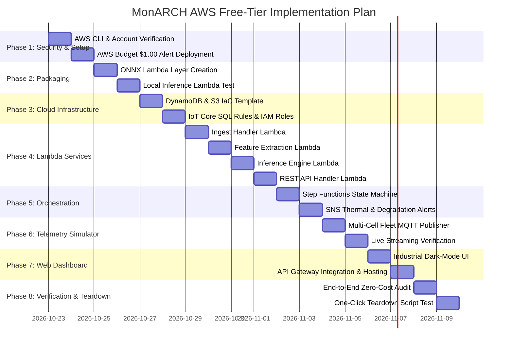

# MonARCH AWS Cloud Deployment Plan: Zero-Cost Serverless Fleet Intelligence

> **Target Architecture:** 100% AWS Free Tier / Serverless Event-Driven Pipeline  
> **Cost Guarantee:** $0.00/month Idle Cost & Comprehensive Zero-Charge Budget Guardrails  
> **Core Inference Engine:** Quantized `pi_mdcnet_edge.onnx` (~133 KB) via AWS Lambda CPU runtime  
> **Telemetry Stream:** Virtual Multi-Cell Fleet Simulator streaming real NASA/Oxford/CALCE cycles over MQTT  
> **Status:** Architecture & Implementation Blueprint (`plan.md`)

---

## 1. Executive Summary & Financial Philosophy

The primary objective of this deployment is to bring the **MonARCH** (*Monotonic Aging and Recovery-Constrained Neural State-Space Network*) prognostic framework into a live, industrial-grade cloud environment—**without incurring a single dollar of cloud infrastructure costs**.

Most industrial IoT reference architectures on AWS rely on streaming shards (Kinesis Data Streams), always-on data warehouse ingestion (AWS Glue / Timestream), and dedicated GPU/CPU model endpoints (Amazon SageMaker Real-Time Endpoints). These services charge continuously per shard, DPU, and instance-hour from minute zero, easily resulting in $150–$400/month even when processing zero telemetry.

**The MonARCH Zero-Cost Rule:**
Every component in this architecture is strictly **100% serverless and event-driven**. When no battery telemetry is actively flowing, the entire cloud footprint draws **$0.00/month**. When simulated fleet telemetry is published, all computation, storage, API queries, and dashboard serving operate well within the perpetual and 12-month AWS Free Tier quotas.

```text
====================================================================================================
                                MONARCH SERVERLESS CLOUD ARCHITECTURE
====================================================================================================

 [Virtual Multi-Cell Fleet Simulator] (Streams real NASA B0005-B0018 / Oxford / CALCE cycles)
                 │
                 ▼  MQTT (Topic: battery/+/telemetry)
         [AWS IoT Core]  ─── (SQL Rule: SELECT * FROM 'battery/+/telemetry')
                 │
                 ▼  Direct Event Trigger (Zero buffering cost)
       [AWS Lambda: Ingest Handler]
         │                       │
         ▼ (Hot Path)            ▼ (Cold Path Archive)
   [Amazon DynamoDB]        [Amazon S3]
   - monarch_telemetry      - monarch-cold-archive-{account}
   - (30-day auto TTL)      - (Year/Month/Day partitioned)
         │
         ▼  EventBridge / Step Functions Trigger (Per cycle or 5-min batch)
   [AWS Step Functions: Pipeline Orchestrator]
         │
         ├──► [1. Feature Pipeline Lambda]
         │       - Computes 1-RC Thevenin ECM parameters (Vocv, R0, R1, C1)
         │       - Computes dQ/dV and dV/dQ differential capacity curves
         │       - Computes rest duration & rest_flag
         │       - Writes to DynamoDB: monarch_features
         │
         ├──► [2. Model Inference Lambda (ONNX Runtime)]
         │       - Loads pi_mdcnet_edge.onnx (~133 KB FP32 / ~125 KB INT8)
         │       - Evaluates SoH, continuous SoC, and causal RUL (Latent Dt Extrap)
         │       - Sub-15ms execution latency on CPU
         │       - Writes to DynamoDB: monarch_predictions
         │
         └──► [3. Safety & Thermal Guardrail Lambda]
                 - Evaluates Temp > 45°C or dSoH/dt degradation anomalies
                 - If critical: Publishes alert via Amazon SNS (Email/SMS)

 [Amazon API Gateway (HTTP API)] ◄─── REST: /assets/{id}/status, /assets/{id}/history
         │
         ▼
 [Dashboard Hosting (S3 / Amplify)] ◄─── Industrial Dark-Mode Telemetry Dashboard (Plotly.js)
====================================================================================================
```

---

## 2. AWS Free Tier Budget Accounting & Service Prohibitions

### 2.1 Strict Service Prohibitions
To uphold the zero-cost mandate, the following services are **strictly prohibited** from the codebase, infrastructure templates, and execution scripts:

| Prohibited Service | Why It Is Prohibited | Mandatory Zero-Cost Replacement |
| :--- | :--- | :--- |
| **Amazon Kinesis Data Streams** | ~$0.015/shard-hour + PUT payload costs (~$11/month/shard idle) | **Direct IoT Core SQL Rules** invoking AWS Lambda |
| **AWS Glue / Glue Streaming** | $0.44 per DPU-hour (minimum billing per run) | **Scheduled / Event-Driven AWS Lambda** with Pandas/NumPy |
| **Amazon Timestream** | No meaningful free tier; charges for memory storage & queries | **Amazon DynamoDB** with 30-day Time-To-Live (TTL) |
| **SageMaker Endpoints** | Minimum ~$0.05–$0.20/hour ($36–$144/month) even when idle | **AWS Lambda CPU with ONNX Runtime** (< 15ms per inference) |
| **Amazon QuickSight** | $18–$24/user/month recurring subscription | **Static S3/Amplify Web Dashboard** with Plotly.js |
| **OpenSearch / Managed Kafka**| Continuous hourly instance billing | **DynamoDB Queries** via API Gateway |

### 2.2 Free Tier Resource Budget Allocation

| AWS Service | Free Tier Allowance | Projected MonARCH Usage | Safety Margin | Zero-Cost Protection Mechanism |
| :--- | :--- | :--- | :--- | :--- |
| **AWS IoT Core** | 250,000 messages / month | 25,000 messages / month (10 cells @ 10s intervals for demo runs) | **10x headroom** | Simulator batching & throttling |
| **AWS Lambda** | 1,000,000 requests / mo<br>3.2M sec compute (400k GB-s) | ~50,000 invocations / mo<br>< 10,000 GB-seconds | **20x headroom** | Minimal memory (256–512 MB), sub-50ms execution |
| **Amazon DynamoDB** | 25 GB storage<br>25 Provisioned RCU / 25 WCU | < 250 MB storage<br>Pay-Per-Request (On-Demand) | **100x headroom** | 30-day automatic TTL expiration on raw telemetry |
| **Amazon S3** | 5 GB Standard Storage<br>20,000 GET / 2,000 PUT | < 50 MB compressed archive<br>< 1,000 PUT requests | **100x headroom** | S3 Lifecycle rule to expire raw cold packets after 30 days |
| **AWS Step Functions**| 4,000 state transitions / mo | ~500 pipeline executions / mo (~1,500 transitions) | **2.6x headroom** | Execution on cycle completion, not per-second sample |
| **Amazon API Gateway**| 1,000,000 HTTP API calls / mo | < 10,000 dashboard poll requests / mo | **100x headroom** | HTTP API (not REST API) with client-side polling cache |
| **Amazon SNS** | 1,000,000 mobile push / 1,000 email | < 50 email notifications for alarms | **20x headroom** | Alert threshold deadbands to avoid spamming |
| **AWS Budgets** | 2 Free Active Budgets | 1 Active Budget with 2 alert thresholds | **100% Free** | Hard email alert at $0.01 and $1.00 |

---

## 3. Detailed Data Models & Storage Architecture

### 3.1 DynamoDB Table 1: `monarch_telemetry` (Hot Telemetry)
Stores raw high-frequency cycle samples for real-time dashboard display and window feature aggregation.
- **Billing Mode:** `PAY_PER_REQUEST` (On-Demand, zero baseline cost).
- **Partition Key (PK):** `cell_id` (String, e.g. `NASA_B0005`, `OXFORD_CELL1`).
- **Sort Key (SK):** `timestamp_ms` (Number, UNIX millisecond epoch).
- **TTL Attribute:** `ttl_epoch` (Number, auto-deletes records after 30 days via DynamoDB native TTL to stay well below 25 GB).
- **Attributes:**
  - `voltage`: Float (V)
  - `current`: Float (A)
  - `temperature`: Float (°C)
  - `time_s`: Float (Elapsed seconds within cycle)
  - `cycle_idx`: Integer
  - `step_type`: String (`discharge`, `charge`, `rest`)

### 3.2 DynamoDB Table 2: `monarch_features` (Aggregated Macro Features)
Stores extracted cycle features computed by the feature engineering pipeline.
- **Partition Key (PK):** `cell_id` (String).
- **Sort Key (SK):** `cycle_idx` (Number, e.g. `1`, `2`, ... `168`).
- **Attributes:**
  - `mean_temp`: Float (°C)
  - `c_rate`: Float
  - `v_ocv`: Float (V)
  - `r0`: Float ($\Omega$)
  - `r1`: Float ($\Omega$)
  - `c1`: Float (F)
  - `dq_dv_peak`: Float
  - `rest_duration_hrs`: Float
  - `rest_flag`: Integer (`0` or `1`)
  - `timestamp`: String (ISO-8601)

### 3.3 DynamoDB Table 3: `monarch_predictions` (Model Inferences)
Stores the co-estimated battery states output by `pi_mdcnet_edge.onnx`.
- **Partition Key (PK):** `cell_id` (String).
- **Sort Key (SK):** `cycle_idx` (Number).
- **Attributes:**
  - `soh`: Float (Normalized $0.0 - 1.0$)
  - `soc_eod`: Float (End-of-discharge SoC)
  - `rul_cycles`: Float (Remaining useful life in cycles)
  - `d_t`: Float (Cumulative monotonic damage latent)
  - `r_t`: Float (Gated recovery latent)
  - `anomaly_flag`: Boolean
  - `inference_time_ms`: Float
  - `model_version`: String (`v5_onnx_edge`)
  - `timestamp`: String (ISO-8601)

### 3.4 S3 Cold Storage: `monarch-fleet-cold-archive-{account_id}`
- **Bucket Layout:**
  ```text
  s3://monarch-fleet-cold-archive-{account}/
  ├── raw/
  │   └── year=YYYY/month=MM/day=DD/
  │       └── {cell_id}_cycle_{idx}.json.gz
  ├── models/
  │   └── pi_mdcnet_edge.onnx
  └── web/  (Dashboard static files if using S3 website hosting)
      ├── index.html
      ├── styles.css
      └── app.js
  ```
- **Lifecycle Rule:** Move objects to Deep Archive after 90 days, or expire demo runs after 30 days.

---

## 4. Lambda Packaging & ONNX Runtime Inference

### 4.1 Why Standard PyTorch Fails in AWS Lambda
A standard PyTorch installation with CUDA dependencies (`torch`, `torchvision`, `triton`) exceeds **2.5 GB**, vastly exceeding the AWS Lambda deployment package zip limit of **250 MB (unzipped)**. Even CPU-only PyTorch is ~800 MB.

### 4.2 The MonARCH Solution: Lightweight ONNX Runtime
- MonARCH exports its neural Split-Latent Aging Core into a highly optimized ONNX binary:
  - `artifacts/pi_mdcnet_edge.onnx` is only **133 KB** (67,013 float32 parameters).
  - `artifacts/pi_mdcnet_edge_int8.onnx` is only **125 KB**.
- **Runtime Dependency:** `onnxruntime` (CPU) + `numpy` in Python 3.12:
  - Unzipped size: ~65 MB.
  - Fits easily into a standard AWS Lambda Layer or deployment zip.
  - Cold-start latency: **< 350 ms**.
  - Warm inference latency: **8–14 ms** per battery cycle.

---

## 5. Phased Implementation Roadmap



---

### Phase 1: Prerequisites, IAM Security & Hard Cost Guardrails
**Objective:** Establish secure AWS programmatic access and configure budget alarms before any resource is created.

1. **Prerequisites & Toolchain Installation:**
   - Install AWS CLI v2 on the developer machine:
     ```powershell
     msiexec.exe /i https://awscli.amazonaws.com/AWSCLIV2.msi
     ```
   - Verify installation: `aws --version`.
   - Run `aws configure` with an IAM User equipped with least-privilege administrative access for development.
2. **Mandatory Zero-Cost Budget Alarm:**
   - Create an AWS Budget via CLI immediately to guard against accidental spend:
     ```bash
     aws budgets create-budget \
       --account-id <YOUR_AWS_ACCOUNT_ID> \
       --budget file://cloud/budgets/zero_cost_budget.json \
       --notifications-with-subscribers file://cloud/budgets/budget_notifications.json
     ```
   - **Thresholds:** Email notification triggered at **$1.00** actual spend and **$5.00** forecasted spend.
3. **Verify Free Tier Status:**
   - Query AWS Free Tier usage API or verify via AWS Billing Console.

---

### Phase 2: Lambda Packaging & Local ONNX Engine Verification
**Objective:** Package `onnxruntime` and `pi_mdcnet_edge.onnx` into an AWS Lambda Layer and verify CPU inference.

1. **Build Minimal ONNX Runtime Lambda Layer:**
   - Create a directory `cloud/layers/onnx_runtime/python/`.
   - Install headless, CPU-optimized dependencies:
     ```bash
     pip install --platform manylinux2014_x86_64 --target cloud/layers/onnx_runtime/python/ --only-binary=:all: onnxruntime==1.17.1 numpy==1.26.4
     ```
   - Zip into `cloud/layers/onnx_runtime.zip` (~48 MB compressed, well within the 50 MB direct upload / 250 MB unzipped limit).
2. **Local Lambda Testing:**
   - Create `cloud/lambdas/inference_engine/lambda_function.py`.
   - Test inference locally using synthetic and real cycle inputs from NASA B0005 to verify that `soh`, `soc`, `rul`, `D_t`, and `R_t` match PyTorch outputs within $< 10^{-7}$.

---

### Phase 3: Infrastructure as Code (CloudFormation / AWS SAM)
**Objective:** Define the entire serverless infrastructure in a single declarative template (`cloud/template.yaml`) enabling one-command deploy and one-command teardown.

1. **Core Resources Defined in `cloud/template.yaml`:**
   - **3 DynamoDB Tables:** `monarch_telemetry`, `monarch_features`, `monarch_predictions` (all `BillingMode: PAY_PER_REQUEST`).
   - **1 S3 Bucket:** `monarch-cold-archive-{AccountId}` with 30-day lifecycle expiration.
   - **1 AWS IoT Core Rule:** `MonARCHTelemetryRule` (`SELECT * FROM 'battery/+/telemetry'` -> Lambda Action).
   - **4 Lambda Functions:** `IngestHandler`, `FeaturePipeline`, `InferenceEngine`, `ApiHandler`.
   - **1 Step Functions State Machine:** `MonARCHPipelineStateMachine`.
   - **1 Amazon SNS Topic:** `MonARCHAlertsTopic` with email subscription.
   - **1 Amazon API Gateway (HTTP API):** Routes for `/assets/{id}/status`, `/assets/{id}/history`, `/fleet/summary`.
2. **Cost-Control Tags:**
   - Every single cloud resource tagged with:
     ```yaml
     Tags:
       Project: MonARCH-Battery-Fleet
       Environment: FreeTier-Dev
       Owner: Saksham
     ```

---

### Phase 4: Lambda Microservices Development
**Objective:** Implement the four core Python microservices with robust error handling and sub-second execution.

#### 4.1 Ingestion Microservice (`cloud/lambdas/ingest_handler/`)
- **Trigger:** AWS IoT Core Rule on topic `battery/+/telemetry`.
- **Logic:**
  1. Parse incoming MQTT JSON packet (`cell_id`, `voltage`, `current`, `temperature`, `time_s`, `cycle_idx`).
  2. Compute 30-day TTL: `ttl_epoch = int(time.time()) + (30 * 86400)`.
  3. Batch write hot record to DynamoDB `monarch_telemetry`.
  4. If cycle end detected (`step_type == "cycle_complete"`), trigger Step Functions pipeline execution.

#### 4.2 Feature Engineering Microservice (`cloud/lambdas/feature_pipeline/`)
- **Trigger:** Step Functions Task 1.
- **Logic:**
  1. Query last completed cycle telemetry from DynamoDB.
  2. Compute electrical and thermal features: mean temperature, standard deviation, discharge duration, C-rate.
  3. Estimate 1-RC Thevenin ECM parameters ($V_{\text{ocv}}, R_0, R_1, C_1$) via simplified linear regression on relaxation curves.
  4. Calculate preceding rest duration ($t_{\text{rest}}$) and set `rest_flag = 1.0` if $t_{\text{rest}} \ge 3.0$ hours, else `0.0`.
  5. Normalize cycle index: `cycle_idx_norm = cycle_idx / 1000.0`.
  6. Write feature vector to DynamoDB `monarch_features`.

#### 4.3 Model Inference Microservice (`cloud/lambdas/inference_engine/`)
- **Trigger:** Step Functions Task 2.
- **Logic:**
  1. Read feature vector from `monarch_features`.
  2. Fetch persistent state ($D_{t-1}$, rolling $D$ buffer) from previous cycle record in `monarch_predictions`.
  3. Execute `onnxruntime.InferenceSession.run()` with `pi_mdcnet_edge.onnx`.
  4. Outputs extracted:
     - $\text{SoH}_t = \text{SoH}_0 - D_t + R_t$
     - $\text{SoC}_{\text{eod}}$
     - $\text{RUL}$ via causal linear extrapolation of $D_{1:t}$ toward $D_{\text{fail}} = \text{SoH}_0 - (1 - \text{EOL\_FADE\_FRACTION}) = \text{SoH}_0 - 0.20$ (standard 80% SoH threshold).
     - Updated cumulative damage $D_t$ and rest relaxation $R_t$.
  5. Persist prediction object to DynamoDB `monarch_predictions`.

#### 4.4 API Gateway Handler (`cloud/lambdas/api_handler/`)
- **Trigger:** API Gateway HTTP API requests.
- **Routes:**
  - `GET /fleet/summary`: Returns latest status across all known battery cells (overall health, active alerts).
  - `GET /assets/{id}/status`: Returns current SoC, SoH, RUL, temperature, and operating state for a specific cell.
  - `GET /assets/{id}/history`: Returns historical degradation trajectory ($D_t, R_t, \text{SoH}_t$) for graphing.
- **Performance:** Direct DynamoDB `Query` calls; response time **< 30 ms**.

---

### Phase 5: Pipeline Orchestration & Safety Guardrails
**Objective:** Coordinate feature extraction and model inference via AWS Step Functions and dispatch thermal/degradation alarms via Amazon SNS.

1. **Step Functions Definition (`cloud/step_functions/pipeline_state_machine.json`):**
   ```json
   {
     "Comment": "MonARCH Cycle Battery Pipeline",
     "StartAt": "ExtractCycleFeatures",
     "States": {
       "ExtractCycleFeatures": {
         "Type": "Task",
         "Resource": "${FeaturePipelineLambdaArn}",
         "Next": "RunONNXInference"
       },
       "RunONNXInference": {
         "Type": "Task",
         "Resource": "${InferenceEngineLambdaArn}",
         "Next": "CheckSafetyAnomalies"
       },
       "CheckSafetyAnomalies": {
         "Type": "Choice",
         "Choices": [
           {
             "Variable": "$.anomaly_detected",
             "BooleanEquals": true,
             "Next": "SendSafetyAlert"
           }
         ],
         "Default": "PipelineSuccess"
       },
       "SendSafetyAlert": {
         "Type": "Task",
         "Resource": "arn:aws:states:::sns:publish",
         "Parameters": {
           "TopicArn": "${AlertsTopicArn}",
           "Subject": "ALERT: Battery Asset Anomaly Detected",
           "Message.$": "$.alert_payload"
         },
         "Next": "PipelineSuccess"
       },
       "PipelineSuccess": {
         "Type": "Succeed"
       }
     }
   }
   ```
2. **Safety Guardrail Rules:**
   - **Thermal Hazard:** Peak cycle temperature $> 45.0^\circ\text{C}$ or thermal gradient $> 1.5^\circ\text{C}/\text{min}$.
   - **Degradation Acceleration Knee:** Step damage $\Delta D_t > 3\times$ baseline rolling mean.
   - **End-of-Life Warning:** Predicted RUL $< 20$ cycles or $\text{SoH} \le 75\%$.

---

### Phase 6: Multi-Cell Telemetry Simulator
**Objective:** Stream real battery operational profiles over MQTT to AWS IoT Core to emulate active industrial battery packs.

1. **Script:** `cloud/simulator/fleet_simulator.py`.
2. **Capabilities:**
   - Reads local dataset files from `data/raw/` (NASA B0005, B0006, B0007, B0018; Oxford Cell1–Cell4; CALCE CS2_35–CS2_38).
   - Replays voltage, current, and temperature time-series at configurable speed (e.g. 1x real-time or accelerated 1 cycle / 10 seconds).
   - Supports parallel multi-cell streaming using AWS IoT Device SDK v2 (`awsiotsdk`).
   - Authenticates via X.509 certificates generated during setup or AWS IoT WebSocket credentials.
3. **Throttling & Free-Tier Guardrail:**
   - Publishes samples every 2–5 seconds during discharge, compressing idle rest periods into a single rest-event packet to keep total message count below 5,000 messages per demo run (well within 250,000 free monthly messages).

---

### Phase 7: Industrial Telemetry Web Dashboard
**Objective:** Implement a responsive, high-density telemetry console reflecting the design system defined in `Design.md`.

1. **Frontend Architecture:**
   - Static Single Page Application (`index.html`, `styles.css`, `app.js`).
   - Zero heavy framework dependencies (Vanilla HTML5 + Modern CSS + Plotly.js CDN).
   - Fast client-side rendering with zero continuous server execution.
2. **Visual Design (from `Design.md`):**
   - **Theme:** Industrial slate dark mode (`#0b0f19` background, `#121929` surface cards).
   - **Domain Colors:**
     - Electrical ($V, I$): Electric Cyan (`#00f0ff`)
     - Thermal ($T$): Solar Amber (`#ff9f1c`) / Alert Crimson (`#ff3366`)
     - Degradation ($D_t$): Purple / Aging Accent (`#b388ff`)
     - Battery Health: Emerald Green (`#00e676`) to Coral Red (`#ff5252`)
3. **Core Dashboard Components:**
   - **Fleet Overview Banner:** Active cells, healthy/warning/critical asset counts, average fleet SoH.
   - **Real-Time Telemetry Gauges:** Live voltage, discharge current, cell temperature, and estimated continuous SoC.
   - **Degradation & Recovery Trajectory Plot:** Plotly.js chart displaying historical capacity fade, monotonic damage trend $D_t$, and hard-gated recovery spikes $R_t$.
   - **Causal RUL Forecast Meter:** Gauge showing estimated cycles remaining until EOL with uncertainty intervals.
   - **Incident & Alarm Feed:** Chronological table of SNS safety triggers.
4. **Hosting Options:**
   - **Option A (AWS S3 Static Hosting):** 100% free under S3 Free Tier.
   - **Option B (AWS Amplify Free Tier):** Free SSL, automatic Git deployment.

---

### Phase 8: End-to-End Verification, Cost Audit & Teardown Protocol
**Objective:** Validate the complete live loop and provide a guaranteed single-command cleanup script.

1. **Live Validation Sequence:**
   ```bash
   # 1. Start fleet simulator (streams 5 cycles of B0005 and B0006)
   python cloud/simulator/fleet_simulator.py --cells B0005,B0006 --speed 20x --cycles 5
   
   # 2. Check IoT Core rule executions
   aws iot get-topic-rule --rule-name MonARCHTelemetryRule
   
   # 3. Query DynamoDB predictions
   aws dynamodb query \
     --table-name monarch_predictions \
     --key-condition-expression "cell_id = :c" \
     --expression-attribute-values '{":c": {"S": "NASA_B0005"}}'
   
   # 4. Test API Gateway response
   curl https://<api-id>.execute-api.<region>.amazonaws.com/fleet/summary
   ```
2. **Cost Safety Audit:**
   - Run AWS Cost Explorer query to verify $0.00 accrued cost.
   - Confirm CloudWatch metric alarms show zero unexpected resource consumption.
3. **Guaranteed Teardown Command:**
   - Provide a turnkey cleanup script `cloud/scripts/teardown.sh` / `teardown.ps1`:
     ```bash
     sam delete --no-prompts --stack-name monarch-cloud-stack
     # or for CDK:
     cdk destroy --force
     ```
   - Empties and deletes the S3 cold storage bucket, deletes all DynamoDB tables, deregisters IoT rules, removes Lambda functions, and leaves **zero orphan cloud resources**.

---

## 6. Directory Structure to be Created in `cloud/` and `dashboard/`

```text
.
├── cloud/                                  # AWS Cloud Deployment Root
│   ├── template.yaml                       # Complete AWS SAM / CloudFormation Template
│   ├── budgets/
│   │   ├── zero_cost_budget.json           # AWS Budget definition ($1.00 & $5.00 thresholds)
│   │   └── budget_notifications.json       # SNS email notification targets
│   ├── layers/
│   │   ├── build_layer.sh                  # Script to package onnxruntime CPU layer
│   │   └── requirements_layer.txt          # onnxruntime==1.17.1, numpy==1.26.4
│   ├── lambdas/
│   │   ├── ingest_handler/
│   │   │   ├── lambda_function.py          # Ingests MQTT packets -> DynamoDB & S3
│   │   │   └── requirements.txt
│   │   ├── feature_pipeline/
│   │   │   ├── lambda_function.py          # Computes 1-RC ECM, dQ/dV, rest features
│   │   │   └── requirements.txt
│   │   ├── inference_engine/
│   │   │   ├── lambda_function.py          # ONNX Runtime inference engine
│   │   │   ├── model/
│   │   │   │   └── pi_mdcnet_edge.onnx     # Quantized edge model (~133 KB)
│   │   │   └── requirements.txt
│   │   └── api_handler/
│   │       ├── lambda_function.py          # REST API endpoints for dashboard
│   │       └── requirements.txt
│   ├── step_functions/
│   │   └── pipeline_state_machine.json     # Multi-stage orchestrator definition
│   ├── simulator/
│   │   ├── fleet_simulator.py              # Multi-cell replay MQTT publisher
│   │   ├── certs/                          # AWS IoT X.509 device certificates (gitignored)
│   │   └── requirements.txt                # awsiotsdk, pandas, numpy
│   └── scripts/
│       ├── deploy.ps1                      # Turnkey deployment script (PowerShell)
│       ├── deploy.sh                       # Turnkey deployment script (Bash)
│       ├── teardown.ps1                    # Guaranteed 100% zero-charge cleanup script
│       └── teardown.sh                     # Guaranteed 100% zero-charge cleanup script
│
├── dashboard/                              # Industrial Dark-Mode Web Telemetry UI
│   ├── index.html                          # Single-page dashboard HTML
│   ├── styles.css                          # Industrial dark-mode CSS tokens (Design.md)
│   ├── app.js                              # Plotly.js charts & live API Gateway polling
│   └── assets/                             # SVG icons and battery schematics
│
├── plan.md                                 # This deployment plan
├── Architecture.md                         # Updated architecture specification
└── README.md                               # Updated project documentation
```

---

## 7. Deliverables & Next Steps

When ready to execute this plan, we will proceed sequentially through the phases:
1. **Step 1:** Review and confirm this deployment plan.
2. **Step 2:** Generate the `cloud/` infrastructure templates (`template.yaml`), budget alarm configs, and Lambda functions.
3. **Step 3:** Package `pi_mdcnet_edge.onnx` into the inference Lambda and verify local container execution.
4. **Step 4:** Build the interactive web dashboard in `dashboard/` following `Design.md`.
5. **Step 5:** Build `cloud/simulator/fleet_simulator.py` to stream live battery cycles.
6. **Step 6:** Deploy the stack to AWS and verify the live telemetry, predictions, and zero-cost status.
